# Print results: designer preview vs. real printout

The test labels in [`print-tests/`](print-tests/) were printed twice on a real Zebra printer. For
each test, this page shows three images side by side:

1. the **preview when printed**: what the designer showed with the code that was printed;
2. the **printout**: a scan of the printed label;
3. the **preview after the fixes**: what the designer showed after the renderer was changed to match
   that printout.

Together they show where the preview matched the printer, where it did not, and how it improved
from round to round. The measurements and the printer behaviour each test found are in
[`print-tests/README.md`](print-tests/README.md#results). Click an image to see it at full size.

## Setup

- **Printer:** Zebra ZD420d, 203 dpi direct thermal, firmware V84.20.23Z (Link-OS 6.4).
- **Media:** 100 × 150 mm die-cut labels. The tests are 100 × 50 mm (T14 is 100 × 150 mm) and print
  at the top of each label.
- **Previews:** the image the designer canvas shows. It comes from the backend renderer
  (`render_zpl` in [`backend/app/render/renderer.py`](../backend/app/render/renderer.py)), here
  run at 203 dpi with the code of the commit named in the column header. The `.zpl` files print
  the same in all three commits (only a comment in T10 changed); T17 was added after round 1.
  These commits are from the project's development history before it was published, so they
  are not in this repository; the code of the last one is what the first public release contains.
- **Printouts:** cut from the scans to the same 100 × 50 mm area (T14: the whole label). They are
  aligned on the label's die-cut top-left corner, not on the print head, so allow about ±1 mm of
  offset.

| Round | Scanned | Printed with | Scan | Fixed in |
|---|---|---|---|---|
| [1](#round-1) | 26 Oct 2026 | `cd290d8` | 150 dpi, colour | `623525f` |
| [2](#round-2) | 26 Oct 2026 | `623525f` | 300 dpi, greyscale | `8670e62` |

### Reading the scans

- The white vertical streaks at x ≈ 404 and 591–593 dots in black areas are dead printhead dots.
  They are in the same place in both rounds.
- The round 1 scan also has a thin vertical line from the scanner.
- Round 2 was fed into the scanner upside down; the images here are turned the right way up. On
  some labels the scanner cut off the last few millimetres on the right, and its feed changed
  the vertical scale by up to 2%.
- The printer keeps settings such as `^BY`, `^LR` and `^PM` from one label to the next. A preview
  shows one label on its own, so it cannot show settings left over from the previous test (T11,
  T13).

## Round 1

Printed with `cd290d8`; the fixes it led to are in `623525f`. T02 and the 300 dpi version of T01
were not printed. T17 was written after this round.

| Test | What it checks | Preview when printed (`cd290d8`) | Printout | Preview after the fixes (`623525f`) | Result |
|---|---|---|---|---|---|
| [T01](print-tests/T01_ruler_203dpi.zpl) | Scale: rulers 0–80 mm across and 0–40 mm down | <a href="print-results/preview-cd290d8/T01_ruler_203dpi.png">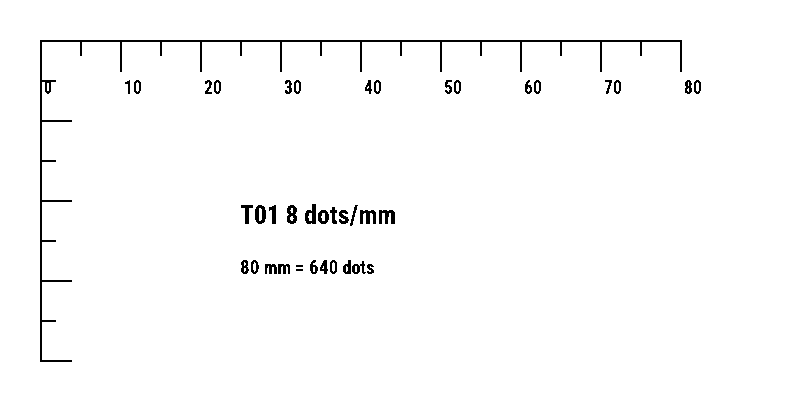</a> | <a href="print-results/print-round-1/T01_ruler_203dpi.png">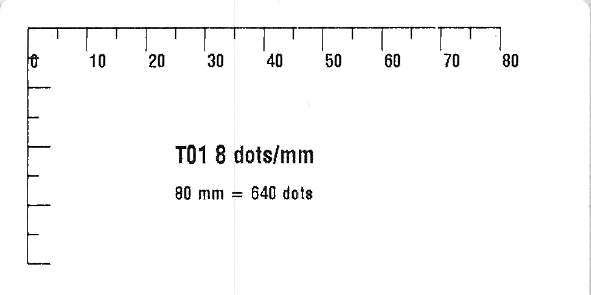</a> | <a href="print-results/preview-623525f/T01_ruler_203dpi.png">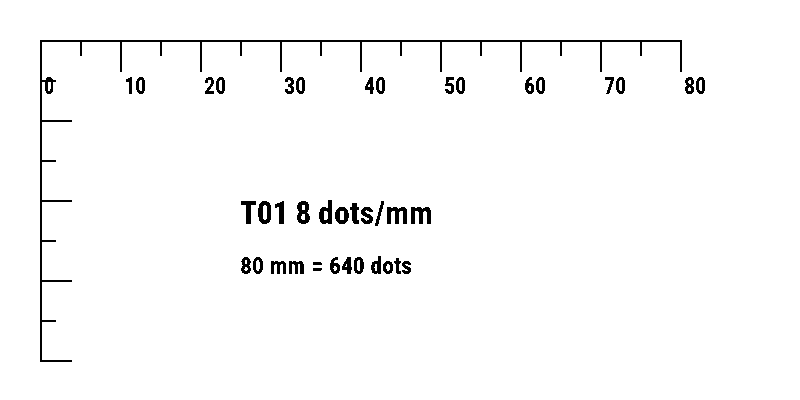</a> | Matches: 80 mm = 640 dots. |
| [T03](print-tests/T03_rotation.zpl) | Field origin of rotated text (N/I/R/B), a rotated bar code and rotated `^FB` blocks | <a href="print-results/preview-cd290d8/T03_rotation.png">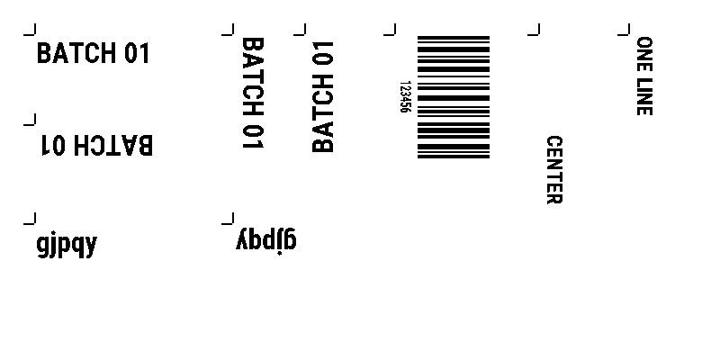</a> | <a href="print-results/print-round-1/T03_rotation.png">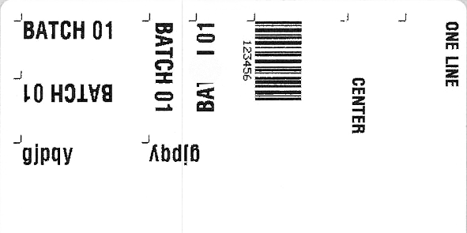</a> | <a href="print-results/preview-623525f/T03_rotation.png">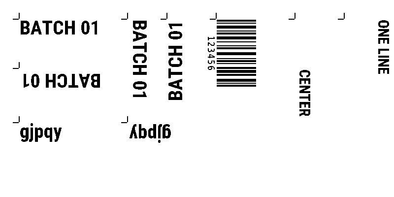</a> | Positions as previewed, but font 0 printed larger (see T04). `^BCR`: bars at `^FO`, text to their left. The 3-line rotated `^FB` printed its one line two lines further right (x ≈ 766). **Fixed:** font 0 size, `^FB` line position. |
| [T04](print-tests/T04_font0_width.zpl) | Font 0 width with `w` left out, `,50,50` and `,50,40`; 8- and 10-dot text | <a href="print-results/preview-cd290d8/T04_font0_width.png">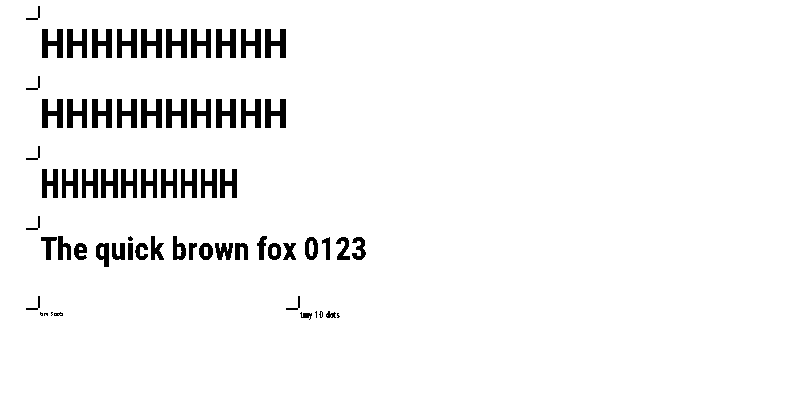</a> | <a href="print-results/print-round-1/T04_font0_width.png">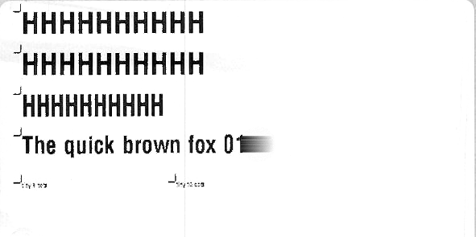</a> | <a href="print-results/preview-623525f/T04_font0_width.png">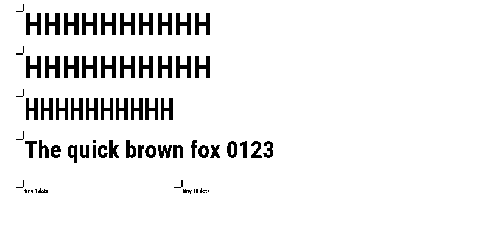</a> | The preview was about 24% too narrow: a left-out width equals the height, and font 0's em is `h`. Printed 302 / 302 / 235 dots; 8-dot text prints like 10. **Fixed.** |
| [T05](print-tests/T05_fonts_chars.zpl) | Fonts A–H and 0: lowercase, `\`, ó ą ł ż €; Swiss 721 by file name | <a href="print-results/preview-cd290d8/T05_fonts_chars.png">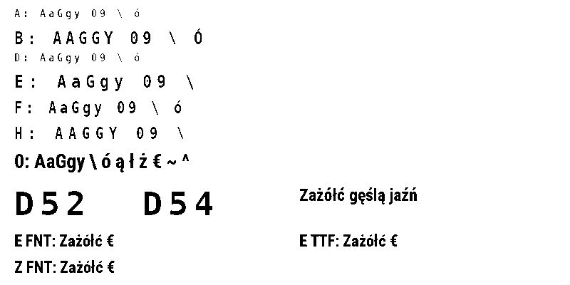</a> | <a href="print-results/print-round-1/T05_fonts_chars.png">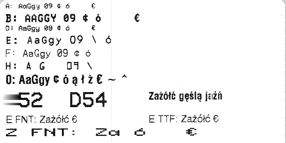</a> | <a href="print-results/preview-623525f/T05_fonts_chars.png">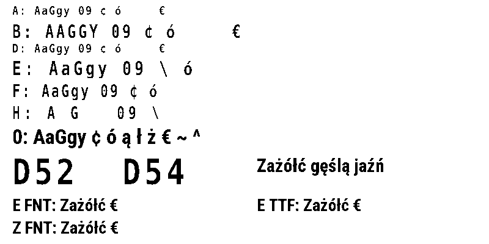</a> | With `^CI28` a backslash prints as ¢ (not in E and H), € prints in A, B and D, font H leaves lowercase blank, font 0 has the Polish letters. **Fixed.** Swiss 721 prints wider, in regular weight. `Z:TT0003M_.FNT` is not on this printer, so the last line fell back to font A. |
| [T06](print-tests/T06_field_block.zpl) | `^FB`: justification, overflow, a word wider than the block, `\&` `\\` `\n`, `^FT` | <a href="print-results/preview-cd290d8/T06_field_block.png">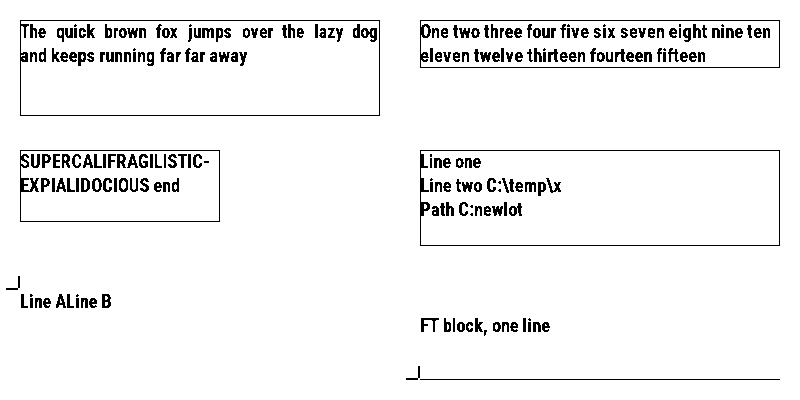</a> | <a href="print-results/print-round-1/T06_field_block.png">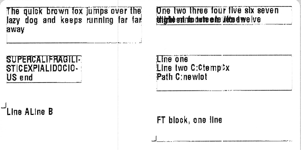</a> | <a href="print-results/preview-623525f/T06_field_block.png">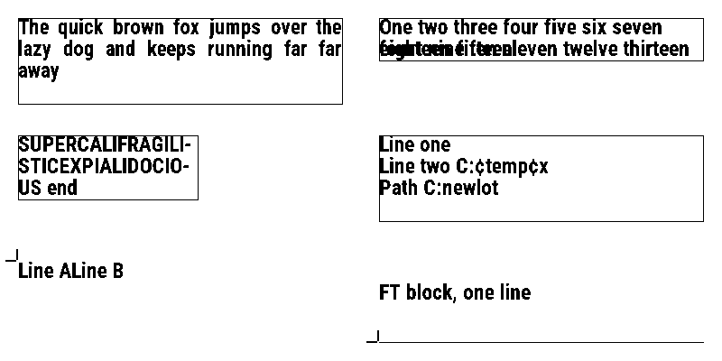</a> | Lines wrapped differently because font 0 was previewed too narrow, and `\\` prints as ¢. **Fixed:** the blocks now wrap and hyphenate as printed. |
| [T07](print-tests/T07_reverse.zpl) | `^FR` over a black box, a white box and a bar code | <a href="print-results/preview-cd290d8/T07_reverse.png">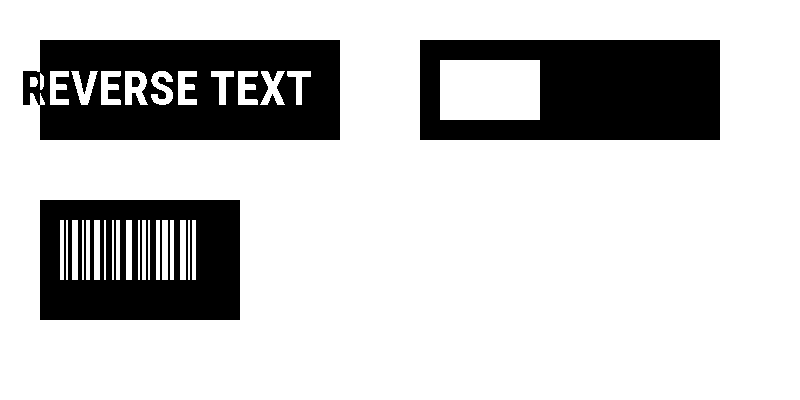</a> |  | <a href="print-results/preview-623525f/T07_reverse.png">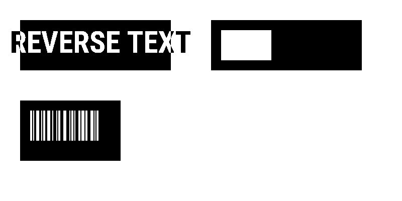</a> | Reversal as previewed; only the font 0 size differed. |
| [T08](print-tests/T08_ratio.zpl) | Code 39 and Interleaved 2 of 5 wide:narrow ratios in whole dots | <a href="print-results/preview-cd290d8/T08_ratio.png">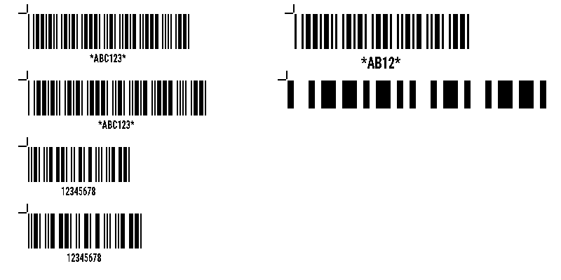</a> |  | <a href="print-results/preview-623525f/T08_ratio.png">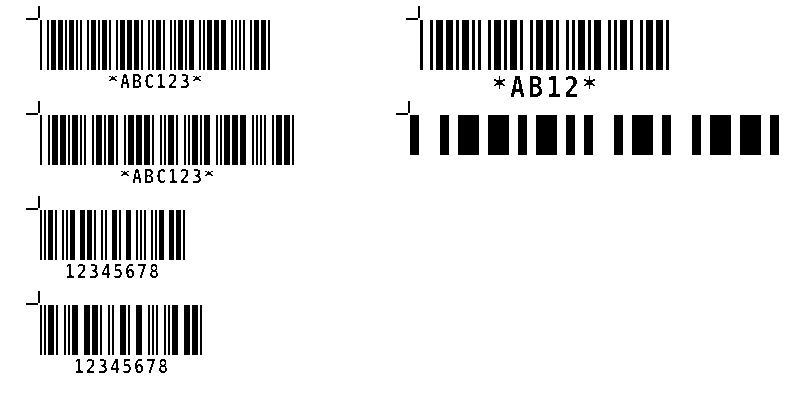</a> | Bar widths within 1–2 dots of the preview (printed 229 / 253 / 144 / 160 / 247 / 367). The text is font A magnified by the module width. **Fixed:** text font. |
| [T09](print-tests/T09_ean_upc.zpl) | EAN-13, UPC-A, EAN-8: padding, truncation, human-readable layout | <a href="print-results/preview-cd290d8/T09_ean_upc.png">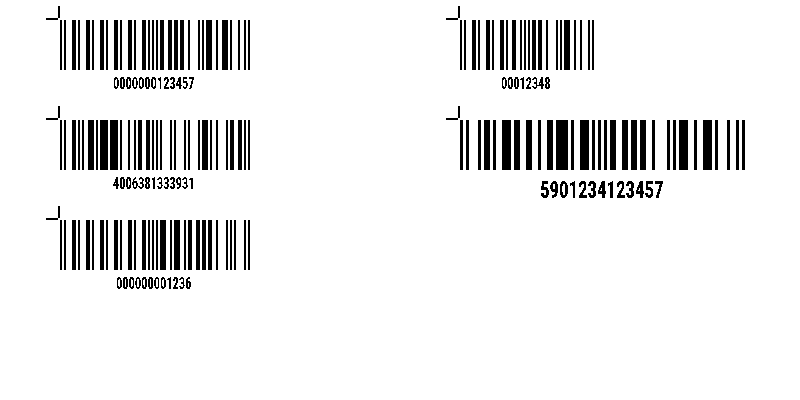</a> | <a href="print-results/print-round-1/T09_ean_upc.png">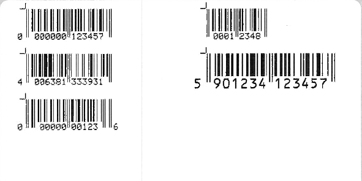</a> | <a href="print-results/preview-623525f/T09_ean_upc.png">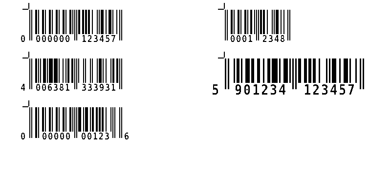</a> | Data as previewed. The printer splits the digits into groups, puts the first digit left of the bars and makes the guard bars 12–13 dots longer. **Fixed:** EAN/UPC layout. |
| [T10](print-tests/T10_pdf417.zpl) | PDF417 row height `h`, and `\` escapes in its data | <a href="print-results/preview-cd290d8/T10_pdf417.png">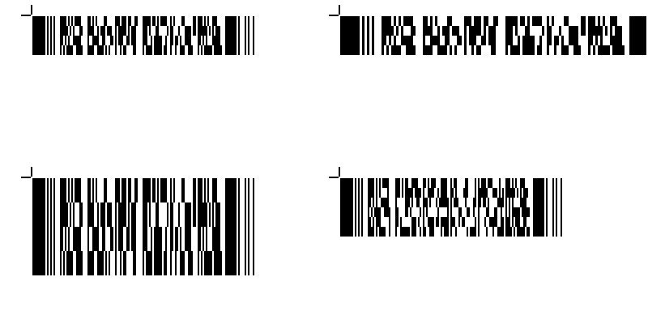</a> | <a href="print-results/print-round-1/T10_pdf417.png">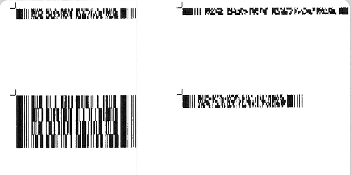</a> |  | Rows are `h` dots high, not `h` × module width as the guide says: the preview was 2–3 times too tall. **Fixed.** |
| [T11](print-tests/T11_qr_datamatrix.zpl) | QR and Data Matrix: data encoding and position | <a href="print-results/preview-cd290d8/T11_qr_datamatrix.png">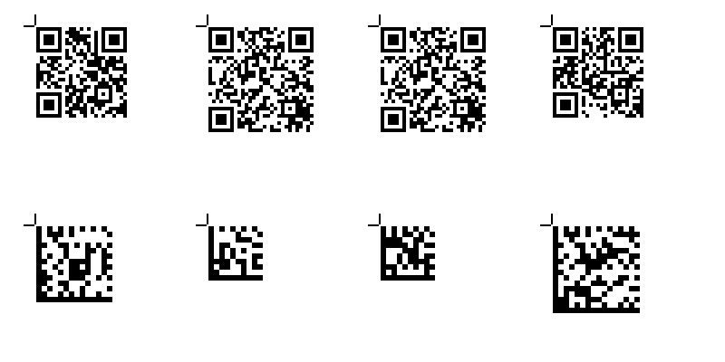</a> | <a href="print-results/print-round-1/T11_qr_datamatrix.png">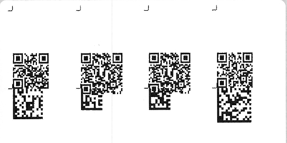</a> | <a href="print-results/preview-623525f/T11_qr_datamatrix.png">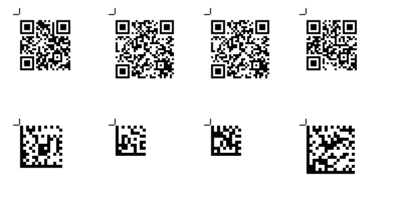</a> | Data Matrix: identical modules. The QR codes printed 120 dots below their brackets: the `^BY` height left over from T10. A preview shows one label on its own and cannot show this; the designer now writes `^BY2,3,10` before every QR code. |
| [T12](print-tests/T12_shapes.zpl) | Shape limits: thick box, `^GD` diagonals, ellipses, rounded corners | <a href="print-results/preview-cd290d8/T12_shapes.png">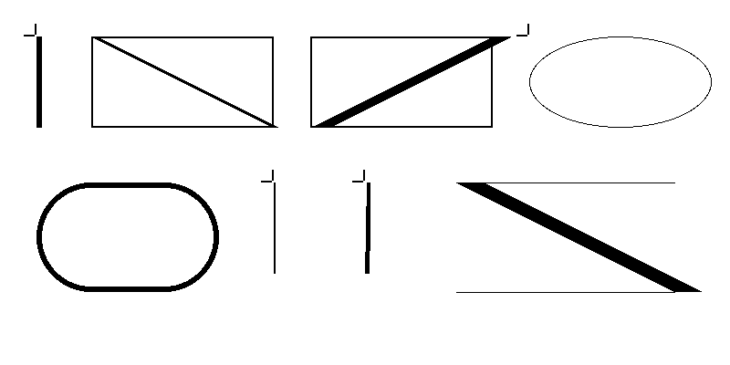</a> | <a href="print-results/print-round-1/T12_shapes.png">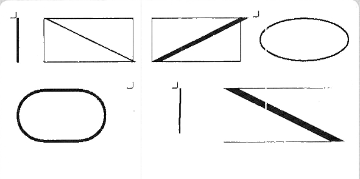</a> | <a href="print-results/preview-623525f/T12_shapes.png">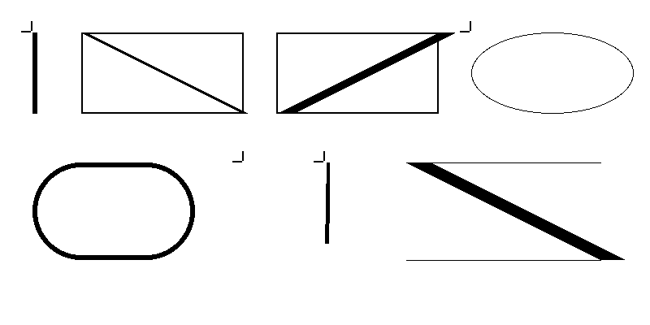</a> | As previewed, except that the 2-dot-wide ellipse (`^GE2,100,2`) prints nothing. **Fixed.** The 1-dot ellipse printed about 3 dots wide (checked again in T17). |
| [T13 (1)](print-tests/T13_sticky_state.zpl) | Label 1: `^LRY^PMY` sent before it (reverse and mirror stay on) | <a href="print-results/preview-cd290d8/T13_sticky_state_1.png">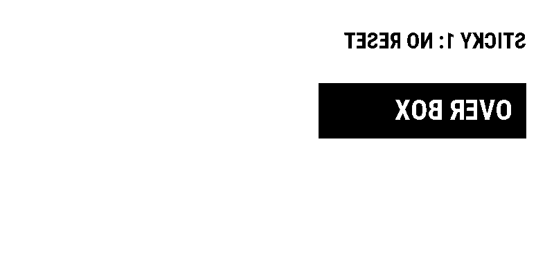</a> | <a href="print-results/print-round-1/T13_sticky_state_1.png">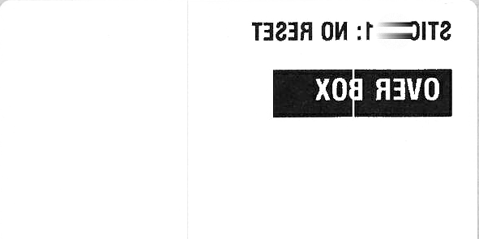</a> |  | Mirrored and reversed, as previewed. |
| [T13 (2)](print-tests/T13_sticky_state.zpl) | Label 2: the same label with `^LRN^PMN` | <a href="print-results/preview-cd290d8/T13_sticky_state_2.png">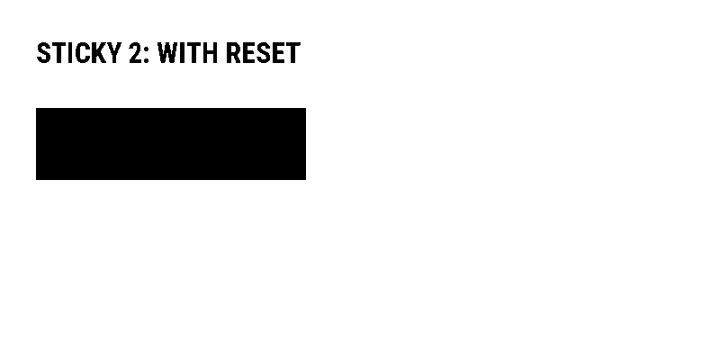</a> | <a href="print-results/print-round-1/T13_sticky_state_2.png">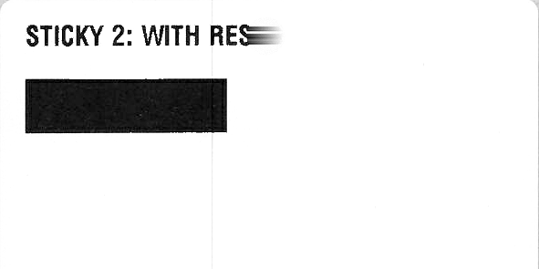</a> | <a href="print-results/preview-623525f/T13_sticky_state_2.png">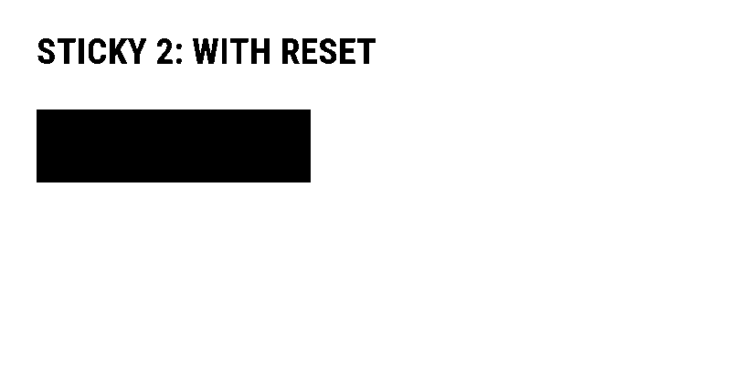</a> | Normal, as previewed (OVER BOX is black on black). |
| [T14](print-tests/T14_gf_99999_100x150.zpl) | A `^GF` image over 99,999 bytes (100 × 150 mm label) | <a href="print-results/preview-cd290d8/T14_gf_99999_100x150.png">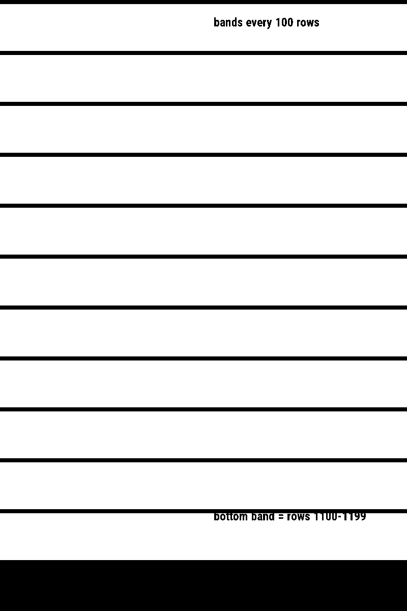</a> | <a href="print-results/print-round-1/T14_gf_99999_100x150.png">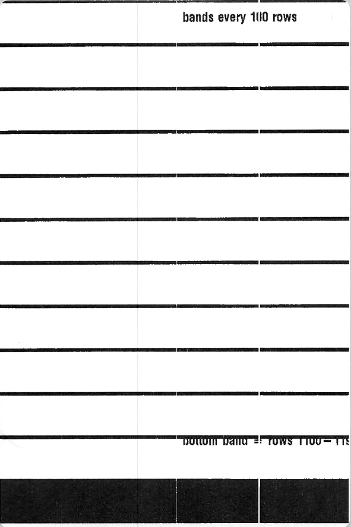</a> | <a href="print-results/preview-623525f/T14_gf_99999_100x150.png">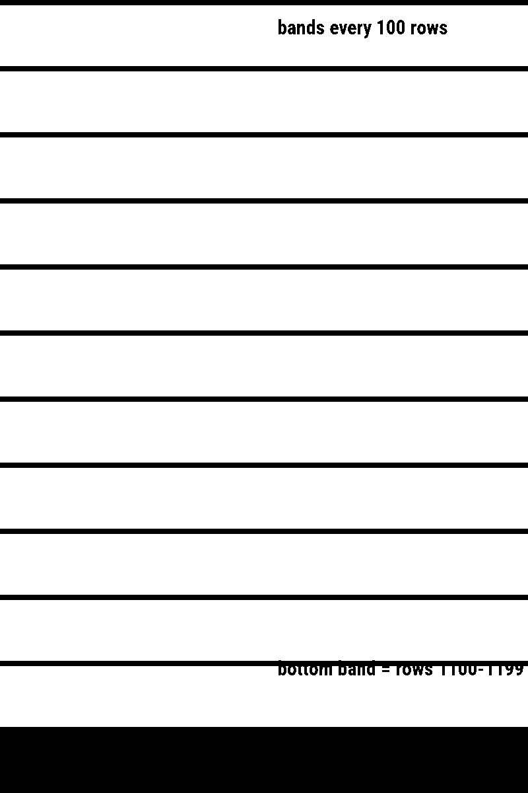</a> | Every band printed, the bottom one too: Link-OS accepts more than 99,999 bytes. |
| [T15](print-tests/T15_font_directory.zpl) | The printer's own directory of E: and Z: (`^WD`) | Not previewed | <a href="print-results/print-round-1/T15_font_directory_E.png">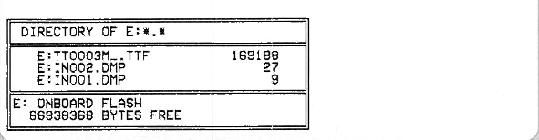</a> [Z: directory (3 labels)](print-results/print-round-1/T15_font_directory_Z.png) | Not previewed | E: has `TT0003M_.TTF` (Swiss 721). Z: has font 0 (`0.TTF`), A–H and P–V; no `TT0003M_`. |
| [T16](print-tests/T16_newer_firmware.zpl) | Right justification (`^FO`/`^FT`/`^FW` z = 1); `^TB` text blocks next to an `^FB` | <a href="print-results/preview-cd290d8/T16_newer_firmware.png">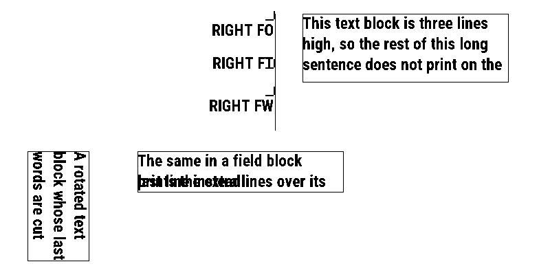</a> | <a href="print-results/print-round-1/T16_newer_firmware.png">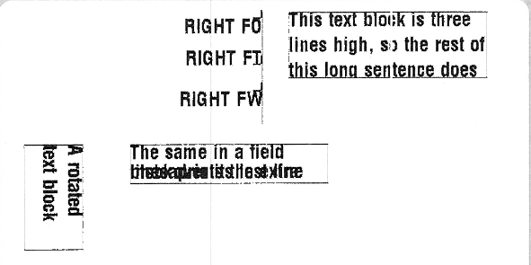</a> | <a href="print-results/preview-623525f/T16_newer_firmware.png">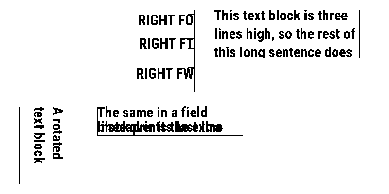</a> | Right justification as previewed. The text blocks wrapped differently (font 0 width). **Fixed:** `^TB` lines are 1.25 × h apart (38 dots at h = 30) and print while their baseline fits. |

## Round 2

Printed with `623525f`, all tests from T01 to T17; the fixes it led to are in `8670e62`. The
300 dpi version of T01 was not printed (it needs a 300 dpi printer).

| Test | What it checks | Preview when printed (`623525f`) | Printout | Preview after the fixes (`8670e62`) | Result |
|---|---|---|---|---|---|
| [T01](print-tests/T01_ruler_203dpi.zpl) | Scale: rulers 0–80 mm across and 0–40 mm down |  | <a href="print-results/print-round-2/T01_ruler_203dpi.png">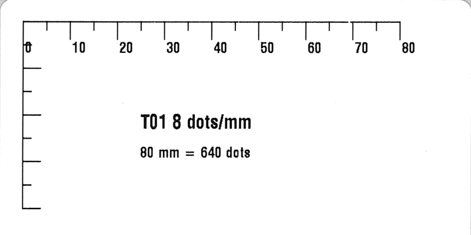</a> | <a href="print-results/preview-8670e62/T01_ruler_203dpi.png">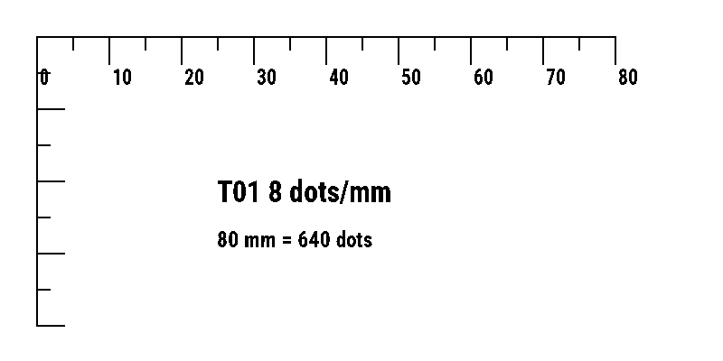</a> | Matches: 80 mm = 640 dots. |
| [T02](print-tests/T02_code128.zpl) | Code 128: subsets, a literal `>`, the UCC check digit, the font of the text | <a href="print-results/preview-623525f/T02_code128.png">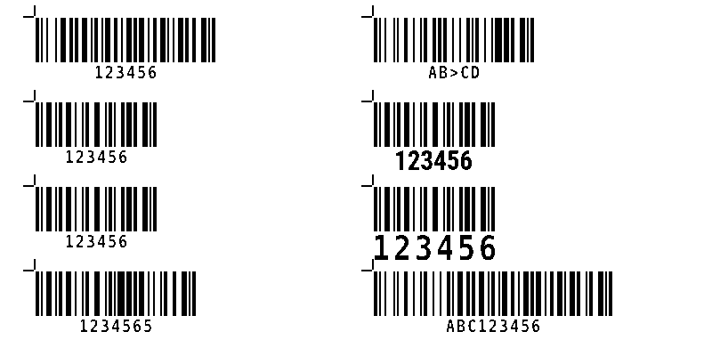</a> | <a href="print-results/print-round-2/T02_code128.png">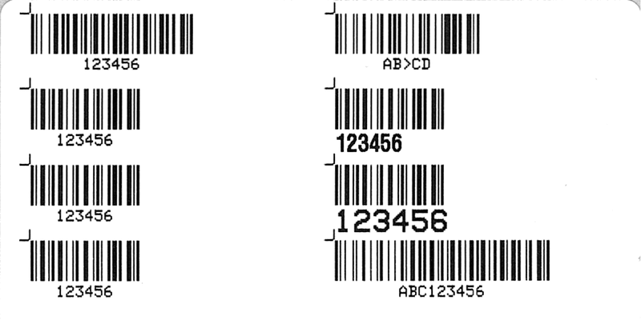</a> | <a href="print-results/preview-8670e62/T02_code128.png">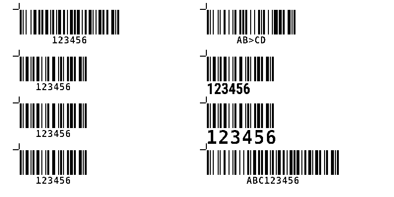</a> | Widths as previewed (202 / 136 / 136 / 136 / 180 / 268 dots). In mode N the UCC check digit flag does nothing: T02d prints 123456, not 1234565. Text in an `^A` font starts at the bars' left edge. **Fixed:** both; the designer no longer offers the check digit for Code 128. |
| [T03](print-tests/T03_rotation.zpl) | Field origin of rotated text (N/I/R/B), a rotated bar code and rotated `^FB` blocks |  | <a href="print-results/print-round-2/T03_rotation.png">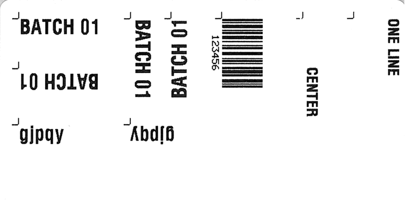</a> | <a href="print-results/preview-8670e62/T03_rotation.png">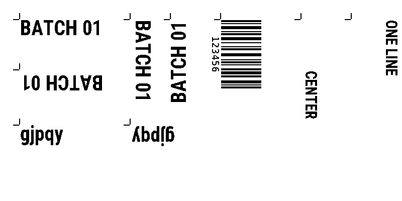</a> | As previewed. |
| [T04](print-tests/T04_font0_width.zpl) | Font 0 width with `w` left out, `,50,50` and `,50,40`; 8- and 10-dot text |  | <a href="print-results/print-round-2/T04_font0_width.png">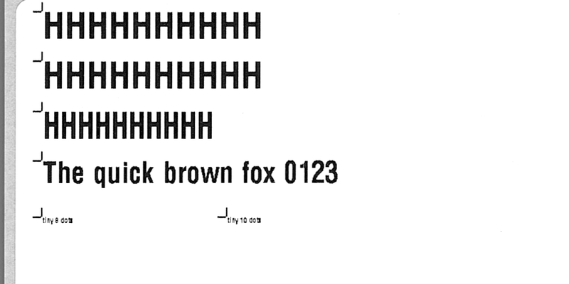</a> |  | 302 / 302 / 235 dots as previewed; capitals about 37 dots high. **Fixed:** font 0 capitals drawn 6% taller. |
| [T05](print-tests/T05_fonts_chars.zpl) | Fonts A–H and 0: lowercase, `\`, ó ą ł ż €; Swiss 721 by file name |  |  |  | As previewed, except for what the preview cannot know: Swiss 721 prints wider and in regular weight, and `Z:TT0003M_.FNT` falls back to font A. |
| [T06](print-tests/T06_field_block.zpl) | `^FB`: justification, overflow, a word wider than the block, `\&` `\\` `\n`, `^FT` |  |  |  | As previewed. T06b's overprinted line breaks a little differently: font 0 lines are within 2–4% of the printer's width. |
| [T07](print-tests/T07_reverse.zpl) | `^FR` over a black box, a white box and a bar code |  |  |  | As previewed. |
| [T08](print-tests/T08_ratio.zpl) | Code 39 and Interleaved 2 of 5 wide:narrow ratios in whole dots |  |  |  | As previewed. |
| [T09](print-tests/T09_ean_upc.zpl) | EAN-13, UPC-A, EAN-8: padding, truncation, human-readable layout |  |  |  | Each digit group sits against the centre guard (the preview centred it). At `^BY3` the digits are larger than font A × 3. **Fixed:** digit group position. |
| [T10](print-tests/T10_pdf417.zpl) | PDF417 row height `h`, and `\` escapes in its data |  |  |  | Row heights as previewed. T10d: the printer drops a backslash before other characters (`C:\new` reads "C:new") and packs the data into 5 rows, not 6. **Fixed:** backslash. |
| [T11](print-tests/T11_qr_datamatrix.zpl) | QR and Data Matrix: data encoding and position |  |  |  | All codes scan as previewed; the printer picks other QR mask patterns. The QR codes are 118 dots low: the `^BY` height from T10, less 2. **Fixed:** QR offset is the `^BY` height less 2 dots. |
| [T12](print-tests/T12_shapes.zpl) | Shape limits: thick box, `^GD` diagonals, ellipses, rounded corners |  |  |  | As previewed, except the 1-dot ellipse prints 3 dots wide (see T17). **Fixed.** |
| [T13 (1)](print-tests/T13_sticky_state.zpl) | Label 1: `^LRY^PMY` sent before it (reverse and mirror stay on) |  |  |  | As previewed. |
| [T13 (2)](print-tests/T13_sticky_state.zpl) | Label 2: the same label with `^LRN^PMN` |  |  |  | As previewed. |
| [T14](print-tests/T14_gf_99999_100x150.zpl) | A `^GF` image over 99,999 bytes (100 × 150 mm label) |  |  |  | As in round 1. |
| [T15](print-tests/T15_font_directory.zpl) | The printer's own directory of E: and Z: (`^WD`) | Not previewed |  [Z: directory (3 labels)](print-results/print-round-2/T15_font_directory_Z.png) | Not previewed | Same listing as round 1. |
| [T16](print-tests/T16_newer_firmware.zpl) | Right justification (`^FO`/`^FT`/`^FW` z = 1); `^TB` text blocks next to an `^FB` |  |  |  | As previewed: 38-dot line pitch at h = 30, descenders cut at the block. |
| [T17](print-tests/T17_follow_ups.zpl) | Round 1 follow-ups: `^TB` line spacing, QR offset, ellipse thickness, Code 128 text above the bars, EAN guards |  |  |  | `^TB`: 4 and 2 lines, as previewed. QR 8 and 58 dots low (preview: 10 and 60). Ellipses t = 1–4 print 3, 3, 4, 5 dots. Both Code 128 texts stand above the bars, outside `^FO`, with the bars at `^FO`. EAN guards 12 dots longer. **Fixed:** QR offset, ellipse thickness, text-above position. |

## Known differences that remain

The previews at `8670e62` still differ from the printer in these places:

- **Fonts the printer does not have** (T05): `Z:TT0003M_.FNT` is not on this printer, so it prints
  in font A. The preview cannot know which fonts a printer has.
- **Swiss 721** (T05): the preview draws it with the preview font. The printer's is regular
  weight and wider.
- **Font 0** (T06): it is previewed with Roboto Condensed, and whole lines come within 2–4% of the
  printer's width. A line that only just fits can break differently.
- **PDF417** (T10d): the printer can pack the data into fewer rows than the preview.
- **QR codes** (T11): the printer picks other mask patterns. The codes scan the same.
- **EAN/UPC at `^BY3`** (T09): the digits print larger than font A × 3.
- **Settings left over from earlier labels** (T11, T13): see [Reading the scans](#reading-the-scans).
